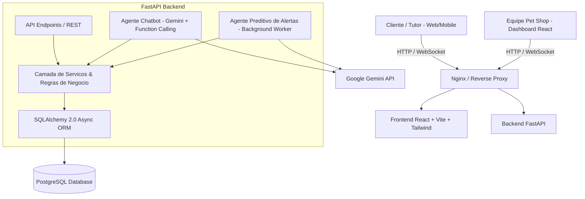
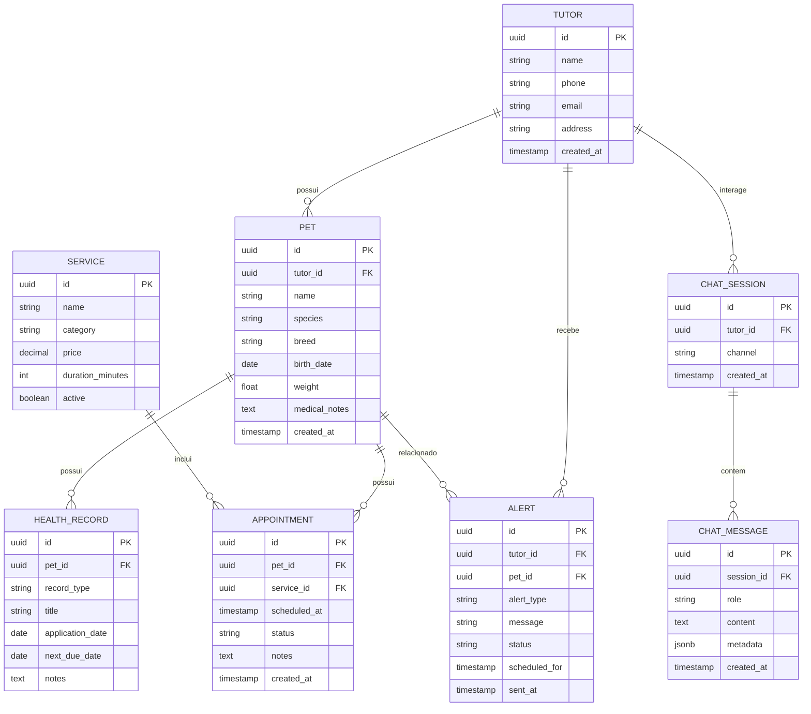

# SmartPetShop - Arquitetura do Sistema

> Documento de Arquitetura de Software do Sistema Inteligente para Pet Shop.
> Stack: Python (FastAPI) + PostgreSQL + Docker + React + Agentes de IA (Gemini).

---

## 1. Visão Geral da Arquitetura

O sistema adota uma arquitetura em camadas modular (Clean Architecture simplificada), priorizando alta coesão, baixo acoplamento, desempenho assíncrono e facilidade de manutenção.



---

## 2. Modelagem do Banco de Dados (PostgreSQL)

O modelo relacional suporta operações transacionais rigorosas (agendamentos, cadastros e finanças) e armazena o histórico dos pets e conversas com a IA.



---

## 3. Especificação dos Agentes de IA

### 3.1. Agente de Atendimento & Agendamento (Chatbot)
- **Modelo:** Gemini 2.5 / 3.x Flash (alta velocidade e suporte a Function Calling).
- **Missão:** Atender clientes via chat, responder dúvidas sobre serviços e preços, verificar horários livres e efetuar agendamentos.
- **Ferramentas (Function Calling):**
  - `check_available_slots(service_id: str, date: str) -> list[str]`
  - `list_services() -> list[dict]`
  - `get_pet_history(tutor_phone: str) -> list[dict]`
  - `create_appointment(pet_id: str, service_id: str, date_time: str) -> dict`

### 3.2. Agente Preditivo de Alertas e Retenção
- **Execução:** Worker agendado (executado diariamente em background).
- **Missão:** 
  1. Identificar vacinas e vermífugos próximos do vencimento (`next_due_date <= hoje + 7 dias`).
  2. Analisar ciclo de banho/tosa (ex: se o pet vem a cada 15 dias e já se passaram 20 dias).
  3. Gerar mensagens personalizadas de alerta com tom acolhedor e chamada para agendamento.

---

## 4. Estrutura de Diretórios Recomendada

```text
SmartPetShop/
├── backend/
│   ├── app/
│   │   ├── api/
│   │   │   └── v1/
│   │   │       ├── endpoints/
│   │   │       │   ├── auth.py
│   │   │       │   ├── tutors.py
│   │   │       │   ├── pets.py
│   │   │       │   ├── services.py
│   │   │       │   ├── appointments.py
│   │   │       │   ├── chat.py
│   │   │       │   └── alerts.py
│   │   │       └── router.py
│   │   ├── core/
│   │   │   ├── config.py
│   │   │   ├── database.py
│   │   │   └── security.py
│   │   ├── models/           # SQLAlchemy ORM Models
│   │   ├── schemas/          # Pydantic Schemas (Request/Response)
│   │   ├── services/         # Regras de Negocio (CRUD, Agendas)
│   │   ├── agents/           # Agentes de IA (Gemini SDK & Tools)
│   │   │   ├── chatbot_agent.py
│   │   │   ├── alert_agent.py
│   │   │   └── tools.py
│   │   └── main.py
│   ├── tests/
│   ├── Dockerfile
│   └── requirements.txt
├── frontend/
│   ├── src/
│   │   ├── components/       # Componentes visuais reutilizaveis
│   │   ├── pages/            # Telas (Dashboard, Pets, Agenda, Chat)
│   │   ├── services/         # Comunicacao com API (Axios / TanStack)
│   │   ├── hooks/
│   │   └── App.tsx
│   ├── Dockerfile
│   ├── package.json
│   └── vite.config.ts
├── docker-compose.yml
├── .env.example
├── .gitignore
└── ARCHITECTURE.md
```

---

## 5. Orquestração com Docker

Ambiente unificado para desenvolvimento e produção:
- **`db`**: PostgreSQL 16 com volume persistente para dados.
- **`backend`**: Container Python 3.11 executando Uvicorn com hot-reload.
- **`frontend`**: Container Node.js executando servidor de desenvolvimento Vite (ou Nginx multi-stage build para produção).

